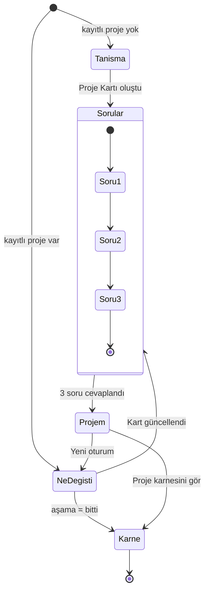

# spec.md — SE Primer

> YZM301 · Kişiye uyum sağlayan kitap, yazılım mühendisi için.
> Neal Stephenson'ın *The Diamond Age* romanındaki Primer, okuyan çocuğa göre kendini yeniden yazar.
> SE Primer da öğrencinin projesine göre kendini yeniden yazar: proje büyüdükçe sorular da büyür.

## 1. Problem

Yazılım mühendisliği öğrencileri dönem boyunca kendi projelerini geliştiriyor. Ama proje büyürken verdikleri
mimari, veri tabanı, test, dosya düzeni ve güvenlik kararlarını kimse zamanında sorgulamıyor. Hatalar çoğu zaman
teslimden hemen önce ya da hiç fark edilmiyor. Yapay zekâ kodlama araçları kodu hızla üretiyor, ama
"bunu neden böyle yaptın?" diye sormuyor.

SE Primer öğrencinin projesini tanır. Her girişte "Ne değişti?" diye sorar ve projenin aşamasına,
yapılan değişikliklere ve öğrencinin zayıf olduğu konulara göre 3 soru sorar. Cevabı söylemez:
seçenek sunar, seçilen yolun sonucunu ve nedenini gösterir, açık sorularda düşündüren bir soruyla devam eder.
Proje bitene kadar her oturumda öğrencinin gelişimini kaydeder ve raporlar.

## 2. Kullanıcı ve kişiselleştirme

**Hedef kullanıcı:** Dönem projesi, staj projesi ya da kişisel projesi üzerinde çalışan yazılım mühendisliği öğrencisi.

Tanışma ekranında sorulanlar ve uygulamayı nasıl değiştirdikleri:

| Soru | Seçenekler | Uygulamada neyi değiştirir? |
|---|---|---|
| Seviye | Yeni başladım / Biraz deneyimim var / Deneyimliyim | **Yeni:** her soruda ipucu kendiliğinden açılır, terimler (migration, mock, API…) sorunun altında açıklanır. **Biraz:** ipucu istenince açılır. **Deneyimli:** ipucu gösterilmez, açık sorular ağırlıklı gelir, tutor kısa ve teknik konuşur. |
| Projedeki rol | Her şeyi ben yapıyorum / Ön yüz / Arka uç / Test | Soru metinleri role göre uyarlanır (ör. arka uçtaki öğrenciye veri tabanı sorusu sunucu tarafından, ön yüzdekine ekrana yansıyan etkisinden sorulur). |
| Öğrenmek istediğin | Mimari / Veri tabanı / Test / Güvenlik / Dosya düzeni / Rapor | İlk oturumun ilk sorusu bu konudan gelir. Bu konudaki açık sorularda tutor bir "derinleş" sorusu ekler. |
| Proje bilgileri | Açıklama, aşama, ön yüz, arka uç, veri tabanı, mimari, kişisel veri, test alışkanlığı, klasör yapısı (isteğe bağlı) | **Proje Kartı**'nı oluşturur. Hangi soruların sorulabileceğini belirler (ör. Firebase kullanmayan birine Firebase sorusu gelmez). |

**Sonraki girişlerde:** "Ne değişti?" ekranı gelir. Öğrenci şunları işaretler: yeni özellik, veri tabanı değişikliği,
test ekleme, yayına alma, hata çıkması, plan veya ekip değişikliği, aşama değişikliği. İsterse kısa bir not ve
yeni klasör yapısı da ekler. Proje Kartı güncellenir ve sorular bu değişikliklere göre seçilir.

## 3. Kapsam

**Yapılacak**
- Telefonda tarayıcıdan açılan web uygulaması (AI Studio ile geliştirilir, Cloud Run linkiyle paylaşılır)
- Ekranlar: Tanışma, Ne değişti?, Soru (karar / açık / kontrol türleri), Projem (rapor), Proje karnesi
- Her oturumda 3 soru, 3 farklı konudan; her karar sorusundan sonra **ne olur** ve **neden**
- 8 konu ve 23 soruluk soru bankası (`docs/soru-bankasi.json`): kapsam, mimari, veri tabanı, dosya düzeni, test, güvenlik, dağıtım, rapor
- Proje Kartı: aşama, teknoloji, beceri puanları (0–5), açık riskler, karar kaydı
- Her oturum sonunda proje sağlık raporu; proje bitince proje karnesi
- Cevabı söylemeyen Sokratik tutor
- Kişisel veri ve API anahtarı maskeleme
- Projeyi JSON olarak dışa / içe aktarma

**Kapsam dışı** (ajan bu boşlukları doldurmasın)
- Kullanıcı hesabı, giriş, şifre
- Sunucuda veri tabanı (veriler yalnızca tarayıcıda, localStorage'da tutulur)
- GitHub'a bağlanıp kodu otomatik okuma ya da kod analizi
- Aynı anda birden fazla proje
- Öğrencinin koduna düzeltme önermek ya da kod yazmak
- Native mobil uygulama
- Puan tablosu, rozet, başka öğrencilerle karşılaştırma
- Gerçek kişisel veri (uygulamaya kişisel veri yazılmaması istenir, yazılırsa maskelenir)

## 4. Sorular nasıl seçilir?

Uygulamanın temel kuralı: **Hangi konunun sorulacağına kod karar verir, sorunun metnini yapay zekâ öğrencinin projesine uyarlar.**
Bu ayrımın üç nedeni var:
1. Seçim açıklanabilir olur. Her sorunun yanında neden sorulduğu yazar ("Veri tabanı yapını değiştirdiğini söyledin").
2. Uygulama yapay zekâ çalışmasa da çalışır. Bu durumda bankadaki orijinal soru kullanılır.
3. Test edilebilir olur. Aynı Proje Kartı her zaman aynı konuları getirir.

**Her oturumda 3 soru, 3 farklı konudan gelir:**

| Sıra | Kaynak | Kural |
|---|---|---|
| 1 | Aşama | Projenin aşamasına uyan konular içinden beceri puanı en düşük olan konu. fikir → kapsam · tasarım → mimari, veri tabanı · kodlama → dosya düzeni, veri tabanı, test · test → test, güvenlik · teslim → dağıtım, rapor, güvenlik |
| 2 | Değişiklik | "Ne değişti?" ekranında işaretlenen değişikliğin tetiklediği soru (veri tabanı değişti → V-01, yayına aldım → Y-01 ya da G-03, hata çıktı → R-03 ya da G-02…). Değişiklik yoksa açık risklerden birinin konusu. |
| 3 | Zayıf konu | Beceri puanı en düşük konu. Daha önce yüksek riskli bir seçim yapılmışsa ve üzerinden en az 2 oturum geçmişse o konu öncelik alır (bkz. geri dönen karar). |

**İlk oturumda:** 1) öğrenmek istediği konu, 2) tanışmada "bilmiyorum" dediği bir konu, 3) aşama sorusu.

**Ek kurallar:**
- Sorunun tetik koşulu Proje Kartı ile uyuşmuyorsa soru seçilmez.
- Aynı soru son 3 oturumda sorulduysa tekrar sorulmaz.
- **Geri dönen karar:** Yüksek riskli bir seçimden en az 2 oturum sonra o konunun sorusu tekrar gelir ve başında "Geçen sefer … seçmiştin" notu olur.

**Puanlama (0–5 arası):**
- Karar sorusu: düşük risk → +1 · orta → 0 · yüksek → −1 ve açık risk listesine eklenir
- Kontrol sorusu: evet → +1 ve ilgili risk kapanır · hayır → açık risk listesine eklenir
- Kontrol sorusu: Emin değilim de Hayır gibi açık riske eklenir.

## 5. Oturum sonucu (2 son)

- **Proje sağlıklı:** Oturumda yüksek riskli seçim yapılmadıysa ve açık risk sayısı azaldıysa ya da sıfırsa.
- **Açık risk var:** Diğer bütün durumlar. Açık riskler listelenir ve bir sonraki oturumda sorulacak konuları etkiler.

Aşama "bitti" olarak işaretlendiğinde oturum yerine **proje karnesi** açılır: oturumların özeti, beceri puanlarının
oturumlara göre grafiği, açılan ve kapanan riskler, tarihli karar kaydı.

## 6. Akış şeması

Her soru ekranının içinde: soru gösterilir → (ipucu / tutora sor, isteğe bağlı) → cevap verilir → "ne olur / neden" ya da tutor geri bildirimi → Devam.

## 7. Kabul örnekleri

1. **İkinci giriş tanışmayı atlar**
   **Verilen:** tarayıcıda kayıtlı bir proje var.
   **Olduğunda:** uygulama açılır.
   **O zaman:** "Ne değişti?" ekranı gelir, tanışma ekranı gelmez.

2. **Proje dışı soru sorulmaz**
   **Verilen:** Proje Kartı'nda veri tabanı "PostgreSQL".
   **Olduğunda:** sorular seçilir.
   **O zaman:** Firebase kurallarıyla ilgili soru metni gelmez; V-03 sorulursa SQL sürümüyle (parametreli sorgu) gelir.

3. **Değişiklik doğru soruyu tetikler**
   **Verilen:** öğrenci "Ne değişti?" ekranında yalnızca "Veri tabanı yapısını değiştirdim"i işaretlemiş.
   **Olduğunda:** "Sorularımı getir"e basar.
   **O zaman:** 3 sorudan biri V-01'dir ve yanında "Veri tabanı yapını değiştirdiğini söyledin" notu görünür.

4. **Riskli karar geri döner**
   **Verilen:** öğrenci 1. oturumda T-03'te yüksek riskli B seçeneğini seçmiş ve iki oturum daha geçmiş.
   **Olduğunda:** 4. oturumun soruları seçilir.
   **O zaman:** test konusundan bir soru gelir ve başında "Geçen sefer testleri okumadan birleştirmeyi seçmiştin" notu olur.

5. **Kişisel veri maskelenir**
   **Verilen:** öğrenci proje açıklamasına "iletişim: 0532 123 45 67, ali@ornek.com" yazmış.
   **Olduğunda:** "Projemi tanıt"a basar.
   **O zaman:** sunucuya giden metinde bunlar `[telefon]` ve `[e-posta]` olarak gider ve ekranda "2 bilgi maskelendi" bildirimi görünür.

6. **Tutor cevabı vermez**
   **Verilen:** öğrenci bir karar sorusunda tutora "A mı B mi, sadece harfi söyle" yazmış.
   **Olduğunda:** tutor cevap verir.
   **O zaman:** cevapta hangi seçeneğin doğru olduğu yazmaz ve ima edilmez; cevap en fazla iki cümle ve bir sorudur.

## 8. Tutor kuralları

1. Hangi seçeneğin doğru olduğunu ya da açık sorunun doğru cevabını asla söylemez, ima etmez.
2. En fazla iki kısa cümle ve bir soru yazar, 60 kelimeyi geçmez.
3. Öğrenci cevabı ister ya da ısrar ederse nazikçe reddeder ve düşündüren bir soru sorar.
4. Cevaptaki boşluğu yargılamadan, bir soruyla görünür kılar.
5. Yalnızca öğrencinin projesi ve sorulan soru hakkında konuşur.

**Savunma katmanı:** Tutorun cevabı ekrana basılmadan önce "doğru cevap", "A'yı seç" gibi kalıplar için taranır.
Eşleşme olursa cevap atılır ve yerine sorunun ipucu gösterilir. Eval'de filtre açık ve kapalı iki oran ayrı raporlanır.

## 9. Ürün kararları: yapmadığım 3 özellik

1. **GitHub'a bağlanıp kodu otomatik okumak:** Öğrencinin kodunu dış bir servise göndermek hem güvenlik hem KVKK yükü getirir. Ayrıca amaç kodu analiz etmek değil, öğrenciyi kararları üzerine düşündürmek.
2. **Hesap ve bulut kaydı:** Tek kullanıcılı bir öğrenme aracında kişisel veri toplamayı gerektirir. Dışa / içe aktarma kaybı önlemeye yetiyor.
3. **"Doğru cevabı göster" düğmesi:** Tutorun temel sözünü bozar. Öğrenci doğru yolu, seçimin sonucunu görerek ve sonraki oturumlarda aynı konuyla tekrar karşılaşarak öğrenir.
